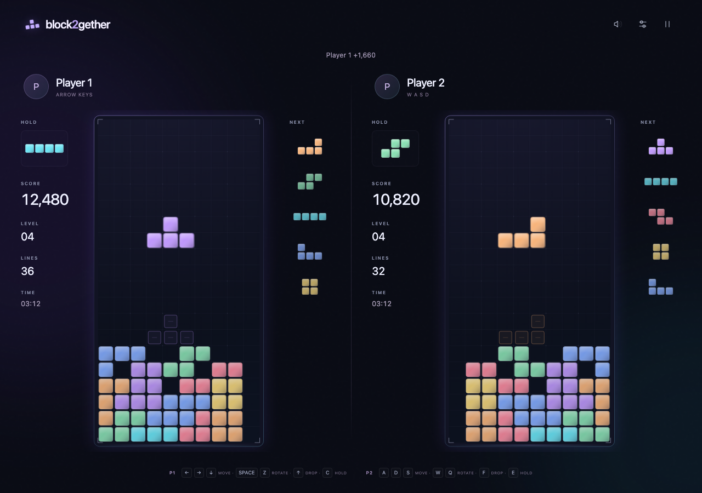
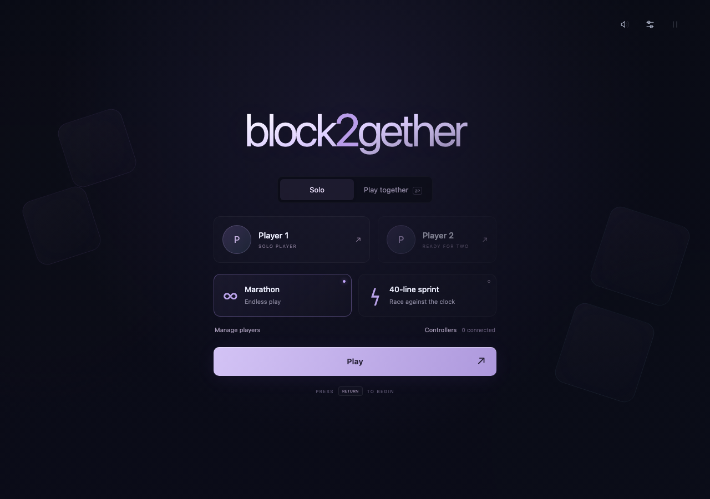
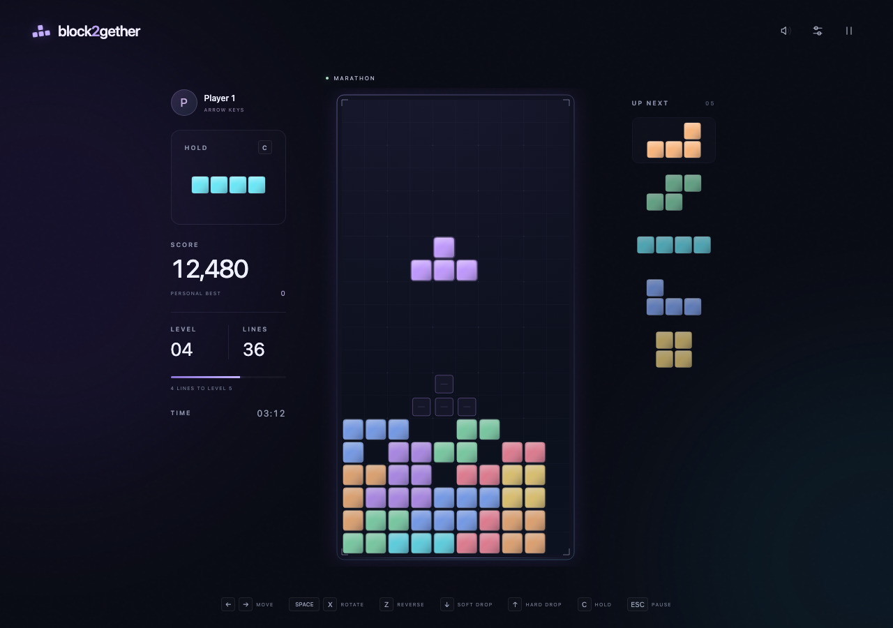

# block2gether

An offline falling-block game for macOS. Play at your own pace, or share a keyboard and chase the high score together.



## The game

- **Marathon:** endless play with increasing gravity.
- **40-line Sprint:** clear forty lines as quickly as you can.
- **Local two-player:** the same piece sequence, two independent boards, highest score wins. When one player tops out, the other keeps playing. The match ends after both finish; equal scores are a draw.
- Seven-bag pieces, SRS rotations, hold, five-piece preview, ghost pieces, instant drop, combos, back-to-back bonuses, T-spins and perfect clears.
- Keyboard and controller input, adjustable movement repeat, reduced motion, and an original synthesized soundtrack.
- Optional player names and photos, saved locally between launches.

There are no accounts, network services, ads, or runtime downloads. This is an independent game, not affiliated with or endorsed by The Tetris Company.

<p>
  
  
</p>

Screenshots use generic players and staged board positions rendered by the game itself.

## Build and play

Requires **macOS 13 or newer** and **Xcode Command Line Tools**. The build produces one app for Apple Silicon and Intel Macs.

```sh
# Install Apple's command-line tools if needed.
xcode-select --install

git clone https://github.com/kcverde/block2gether.git
cd block2gether
bash scripts/build-mac.sh
open dist/block2gether.app
```

Skip the tools installation if it is already installed. You can move the built app into Applications. Node.js is only needed for development and tests; it is not required to build or play.

The local build is ad-hoc signed, not notarized. There is no published installer yet. Apple Silicon has been runtime-tested; Intel is cross-compiled but has not been tested on hardware.

## Controls

### Keyboard

| Action                  | Solo / Player 1 | Player 2       |
| ----------------------- | --------------- | -------------- |
| Move                    | ← / →           | A / D          |
| Soft drop               | ↓               | S              |
| Hard drop               | ↑               | F              |
| Rotate clockwise        | Space / X       | W              |
| Rotate counterclockwise | Z               | Q              |
| Hold / swap             | C / Right Shift | E / Left Shift |

Either Shift key holds in solo mode. **Esc** pauses/resumes, **P** pauses, **M** mutes, **Control–Command–F** toggles fullscreen, and **Command–Q** quits. Switching away from the app pauses the game.

### Controllers

Connect a compatible controller by USB or Bluetooth, then open **Controllers** from the title or pause screen. Assign each device to a player; assigning an occupied slot swaps the devices. Keyboard and controller input can be mixed.

| Action                         | Controller                                                 |
| ------------------------------ | ---------------------------------------------------------- |
| Move                           | D-pad / left stick left or right                           |
| Soft drop                      | D-pad / left stick down                                    |
| Hard drop                      | D-pad Up                                                   |
| Rotate clockwise / confirm     | Bottom face button (A)                                     |
| Rotate counterclockwise / back | Right face button (B)                                      |
| Hold / swap                    | Top face button (Y), left face button (X), either shoulder |
| Pause / resume                 | Menu / Start                                               |

Button labels vary by controller; positions describe the layout. Left/right/down navigate menus. On a settings slider, left/right changes its value and down moves to the next control. Disconnecting a controller pauses play.

Controller routing is tested with Apple's simulated controller snapshots. Physical USB/Bluetooth compatibility still needs testing on real devices; reports with controller model and macOS version are welcome.

## Players and local data

Click a player card or **Manage players** to create, rename, select, or remove a player. Up to eight profiles are supported. Photos are optional PNG, JPEG, or WebP files, resized before storage. **Remove photo** clears a photo without removing the player.

Profiles, settings, and solo records stay on your Mac. Solo best scores and Sprint times are currently shared across profiles on that Mac. Two-player results do not replace solo records. The app ships with generic players and no personal photos.

## Contributing

The game uses **JavaScript, HTML Canvas, and CSS**, hosted in a small **Swift / AppKit / WKWebView** app. There is no game-engine dependency.

For development, install **Node.js 24** (see `.nvmrc`), then:

```sh
npm ci
npm test
npx playwright install chromium
npm run test:browser
# macOS only:
npm run test:native
npm run build
```

Start with [CONTRIBUTING.md](CONTRIBUTING.md) for the workflow, [architecture](docs/architecture.md) for the source map, and [testing](docs/testing.md) for browser and native diagnostics. Bug reports, controller testing, accessibility improvements, and focused pull requests are welcome.

## License

[MIT](LICENSE).
